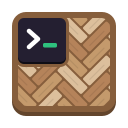
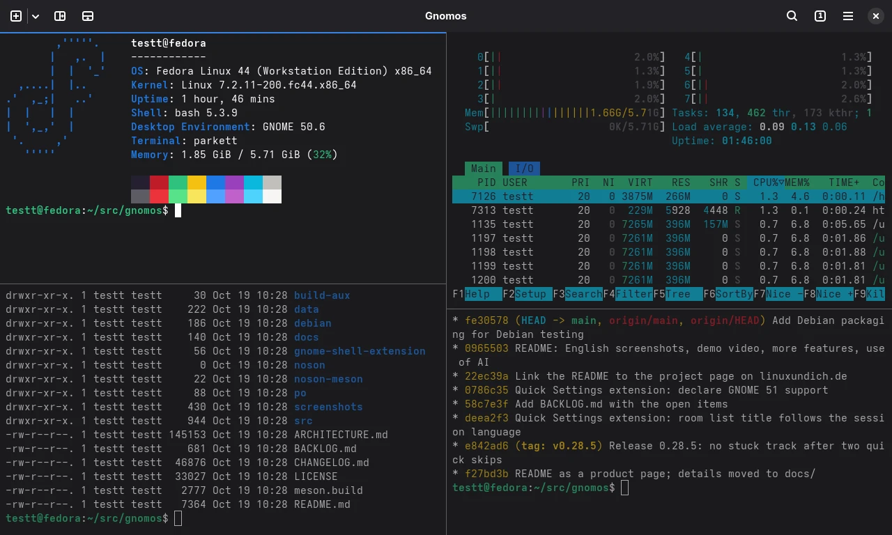
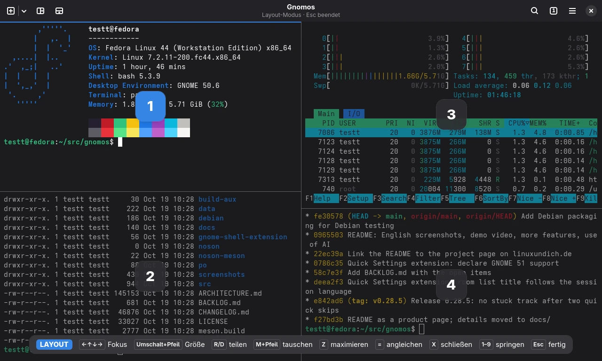
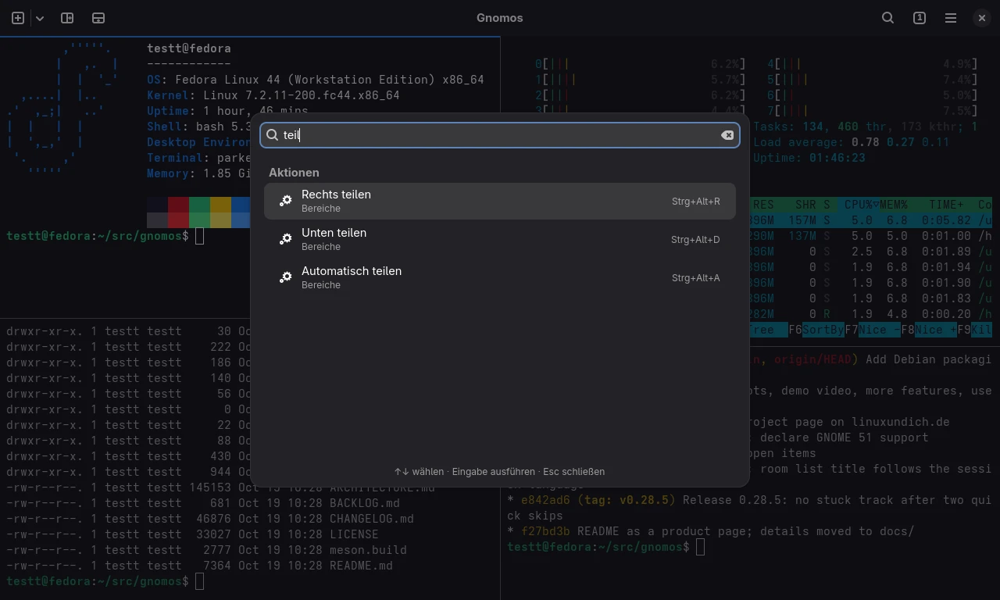
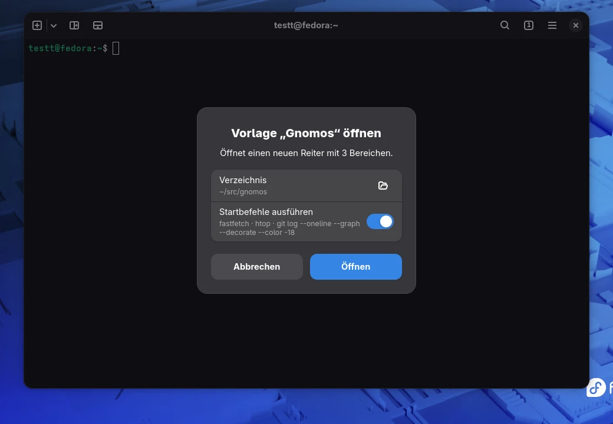
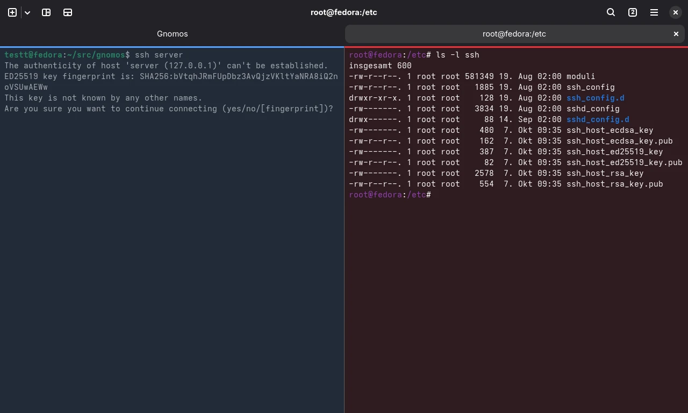
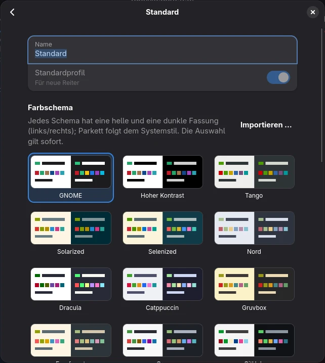
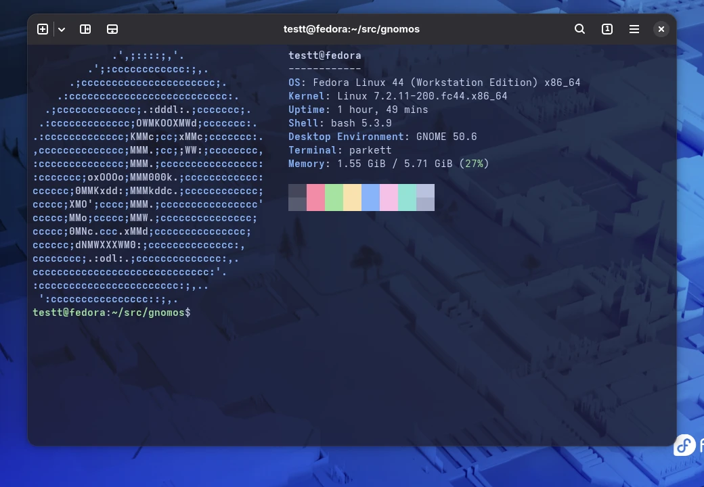
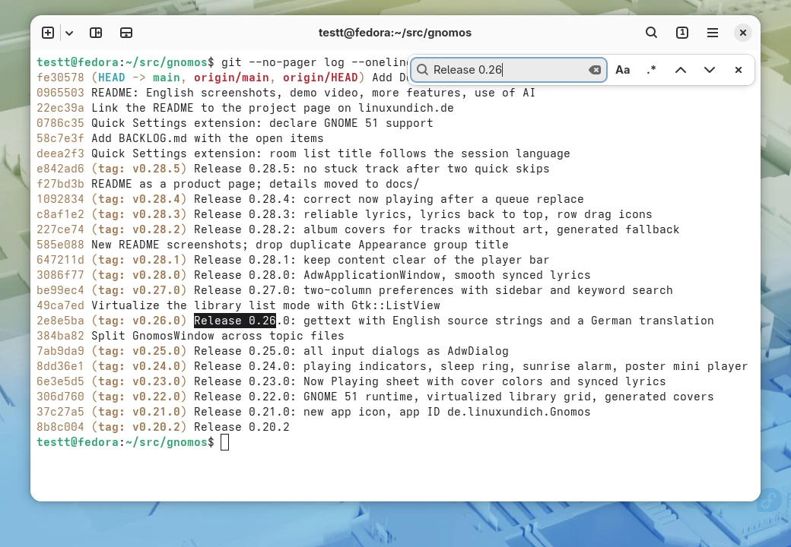
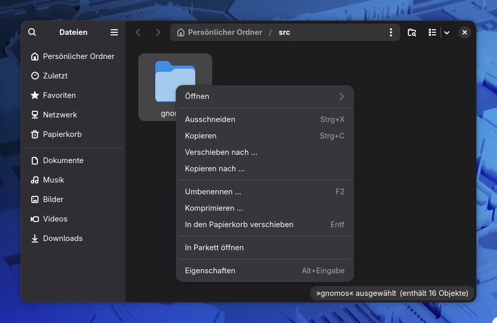

<p align="center">
  
</p>

<h1 align="center">Parkett</h1>

<p align="center"><strong>A terminal for GNOME that splits like Tilix and feels at home in libadwaita.</strong></p>

<p align="center">
  Tabs with freely split panes, a command palette, templates that open your whole workspace
  with one click, and sessions that come back after a restart. Built with GTK&nbsp;4,
  libadwaita and VTE, the same terminal engine as GNOME Console and Ptyxis.
</p>

<p align="center">
  <a href="#install"><strong>Build and install</strong></a>
  &nbsp;·&nbsp;
  <a href="docs/USAGE.md">Usage guide</a>
  &nbsp;·&nbsp;
  <a href="CHANGELOG.md">Changelog</a>
</p>

<p align="center">
  
</p>

> [!NOTE]
> The interface is available in English and German and follows the system language.
> Translations are welcome: see `po/` and [docs/BUILDING.md](docs/BUILDING.md#translations).

## What it does

### Split panes, the way Tilix did it

Split any pane to the right or down with the buttons in the header bar or with a shortcut,
as often as you like. Panes keep their proportions when the window changes size, can be
maximized on their own, and refuse to get so small that nothing fits. Closed a pane by
accident? Undo brings it back within eight seconds, together with the program that was
running in it.

### Layout mode and command palette

Press Ctrl+Shift+L and every pane shows a number. Single keys now move the focus, swap panes,
split, maximize, equalize or close them, and a bar at the bottom lists all keys. The command
palette (Ctrl+Shift+P or a click on the window title) finds every action, tab, pane, template
and profile, and shows the shortcut next to each action so you learn it along the way.

<p align="center">
  
  
</p>

### Templates with start commands

Save a tab as a template, with its layout, the profile of each pane and the command that runs
in it. Opening the template asks for the folder and shows the commands before anything runs.
The commands are typed into the shell, so a pane stays a working shell after Ctrl+C.
Templates are plain TOML files you can edit by hand or keep in your dotfiles.

<p align="center">
  
</p>

### Sessions that come back

Parkett reopens your windows and tabs after a restart, with their layout, profiles, folders and
your own tab titles. It saves continuously, so a session survives logging out or a crash.
Closing the last tab ends the session, and the next start is a fresh one.

### Know where you are

A pane that runs an SSH connection turns blue, a pane with root rights turns red. The colors
come from the color scheme, and every pane decides for itself, so a split with a local shell
next to a remote one stays easy to tell apart.

<p align="center">
  
</p>

### Profiles and color schemes

Profiles set the color scheme, font, cursor shape, bell, starting folder, environment
variables, a command instead of the shell, and what happens when the program ends. Fourteen
color schemes come with a light and a dark variant and follow the GNOME style, or you choose
light or dark yourself. Schemes from Ptyxis and Tilix can be imported. A translucent
background lets the desktop shine through while the header bar stays solid.

<p align="center">
  
  
</p>

### Part of your GNOME desktop

- Opens folders from Nautilus: *In Parkett öffnen* (Open in Parkett) on selected folders, one tab per folder.
- Sends a notification when a long command finishes in a pane you are not looking at; a click takes you there.
- Follows the system monospace font, the accent color and dark mode, works on Wayland and X11.
- Search per pane with case sensitivity and regular expressions, links open with Ctrl+click.
- Every shortcut can be changed or turned off, with a conflict check.
- A command line for scripts and launchers: `parkett -d ~/src --tab`, `parkett -t Logs -- journalctl -f`.

<p align="center">
  
  
</p>

### Careful by default

Parkett asks before it closes a pane in which a program still runs, shows multi-line text
before pasting it, opens links only after Ctrl+click and only for web, mail and local file
addresses, and refuses `file:` links that point to another computer.

## How it works

Parkett is written in Rust. The terminal emulation is VTE, the widget library behind GNOME
Console, Ptyxis and GNOME Terminal. The split layout lives in a small core library without
GTK that is covered by unit tests; the interface only rebuilds the widgets from it, so shells
keep running whenever you split, swap or undo. Settings are stored in GSettings, profiles and
templates as TOML files in `~/.config/parkett/`. Parkett runs no background services and
sends nothing over the network.

## Install

> [!NOTE]
> There are no packages for Parkett yet. AUR and Fedora COPR packages are planned. For now,
> build it from source.

Parkett needs GTK 4.18, libadwaita 1.8 and VTE 0.80 or newer: Arch Linux, Fedora 44 and
Ubuntu 26.04 work. Install the build dependencies:

```sh
# Arch Linux
sudo pacman -S --needed rust meson gtk4 libadwaita vte4

# Fedora 44
sudo dnf install rust cargo meson gtk4-devel libadwaita-devel vte291-gtk4-devel

# Ubuntu 26.04
sudo apt install rustc cargo meson pkg-config libgtk-4-dev libadwaita-1-dev libvte-2.91-gtk4-dev
```

Then build and install Parkett for your user:

```sh
git clone https://github.com/linuxundich/parkett.git
cd parkett
meson setup _build --prefix=$HOME/.local --buildtype=release
meson install -C _build
```

For the entry in the Nautilus context menu, install `nautilus-python` (Ubuntu:
`python3-nautilus`) and restart Nautilus with `nautilus -q`. More options, tests and the
development setup are in [docs/BUILDING.md](docs/BUILDING.md).

## More

- [Usage guide](docs/USAGE.md): shortcuts, layout mode, profiles, templates, sessions, the command line and the file formats
- [Changelog](CHANGELOG.md) · [Backlog and roadmap](BACKLOG.md) · [Architecture](docs/ARCHITECTURE.md) · [Packaging](docs/PACKAGING.md) · [Licenses](docs/LICENSES.md)
- How it was designed: [analysis of Tilix](docs/ANALYSIS.md), [three design concepts](docs/CONCEPTS.md), [prototype](docs/PROTOTYPE.md), [MVP](docs/MVP.md), [quality assurance](docs/QA.md)
- Found a bug or have an idea? [Open an issue](https://github.com/linuxundich/parkett/issues)

## Use of AI

Parkett is AI-assisted. Most of the code, the icon and the documentation were written with AI
assistance, directed by me: I set the requirements, chose between the design concepts, made
the decisions and tested Parkett on my own desktop and in virtual machines. Commits written
with AI assistance carry a `Co-Authored-By` line.

Parkett is free software under the [GPL-3.0-or-later](LICENSE). The bundled color schemes come
from [Ptyxis](https://gitlab.gnome.org/chergert/ptyxis), see [data/palettes](data/palettes/README.md).
